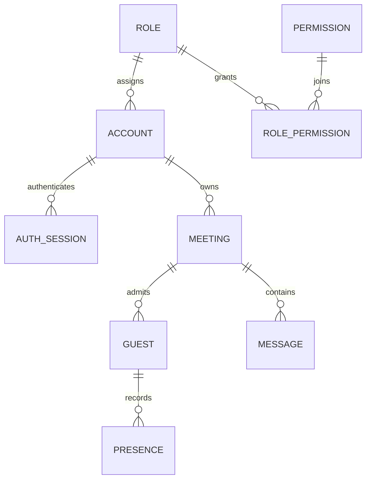

# Схема данных Online Conference

Схема спроектирована до подключения репозиториев. Начальная ревизия Alembic задаёт таблицы, ключи и начальные роли. ORM отображает эту схему.

| Таблица | Первичный ключ | Связи и ограничения |
| --- | --- | --- |
| `roles`, `permissions` | `name` | Каталоги ролей и действий |
| `role_permissions` | `role, permission` | Связь многие-ко-многим. Удаление роли или разрешения чистит привязку |
| `accounts` | `email` | Роль обязательна. Адрес нормализуется. Пароль представлен солью и хешем |
| `auth_sessions` | `token_hash` | Внешний ключ на учётную запись с каскадом. Есть срок действия |
| `meetings` | `id` | Обязательный владелец, уникальное приглашение, длительность 15–180 минут, исходное смещение UTC |
| `guests` | `meeting_id, id` | Заявка относится к одной встрече. Хеш ключа гостя уникален |
| `presence` | `meeting_id, guest_id, seq` | Составной внешний ключ на гостя. У одного гостя может быть несколько интервалов |
| `messages` | `meeting_id, id` | Сообщения принадлежат комнате, скрытие меняет признак видимости |

Удаление встречи на уровне SQL удаляет её гостей и сообщения; интервалы удаляются вместе с гостем. Записи владельцев с сохранёнными встречами защищены внешним ключом. Блокировка владельца оставляет историю. Первичный ключ хранится отдельно от публичного кода приглашения. Ссылка на участника, который показывает экран, хранится в состоянии комнаты: `NULL` означает свободный слот, `0` — организатора. Допустимость этого состояния проверяет модель комнаты.

Учёт присутствия организатора записывается в карточку встречи. Сведения остальных участников хранятся отдельными интервалами. Метки времени сохраняются в UTC. Исходное смещение встречи используется при показе карточки и формировании CSV.
