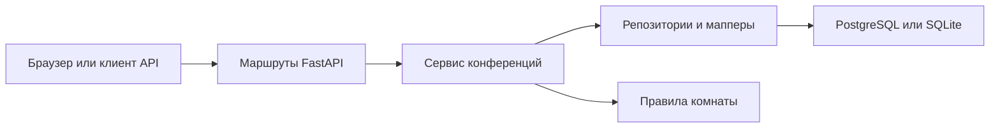

# Веб-версия Online Conference

Быстрый запуск и демонстрационный сценарий приведены в [README](../README.md). Модель базы данных и правила удаления описаны в [ER-диаграмме](ER.md).

## Путь запроса



| Паттерн | Реализация в проекте | Причина применения |
| --- | --- | --- |
| Facade (GoF) | `ConferenceService` | Маршруты вызывают операции встречи и аккаунта через один интерфейс. Сервис координирует авторизацию, правила комнаты и сохранение |
| Adapter (GoF) | Мапперы в `src/storage/mappers.py` | Преобразуют ORM-строки в предметные объекты и обратно. Благодаря этому SQLAlchemy и HTTP используют существующие правила `Room` без переноса этих правил в маршруты или модели базы |
| Repository (Фаулер) | `AccountRepository` и `RoomRepository` | Поиск, блокировки и запись данных сосредоточены в хранилище |
| Service Layer (Фаулер) | `src/usecases/service.py` | Проверки прав, часы и порядок действий собраны в сценариях приложения |
| Unit of Work (Фаулер) | Одна транзакция `Session` на запрос | Изменения комнаты, интервалов и сообщений фиксируются вместе. При исключении транзакция откатывается |

Маршруты получают сервис через `Depends`. Сессия открывается до выполнения операции и завершается до отправки HTTP-ответа. Для изменений одной встречи в PostgreSQL берётся блокировка строки встречи. В SQLite проверка внешних ключей включена для каждого соединения.

## Работа с миграциями

Схема хранится в ревизиях Alembic. На новой базе достаточно применить миграции из корня проекта:

```bash
uv run --locked alembic upgrade head
uv run --locked alembic current
uv run --locked alembic check
```

При изменении схемы сначала уточняют ER-модель и ограничения, затем обновляют декларации SQLAlchemy и создают ревизию командой `uv run --locked alembic revision --autogenerate -m "describe schema change"`. Перед применением ревизии проверяют её порядок операций, ограничения и поведение отката. Роли и разрешения начальной схемы добавляет миграция. Пароль первого администратора передаётся через переменные окружения при запуске приложения, хэш сохраняется в базе. Повторный запуск сохраняет пароль существующей записи.

## Как проверять API

| Маршрут | Кто вызывает | Что возвращает |
| --- | --- | --- |
| `POST /api/sessions` | Администратор или организатор | Данные учётной записи и токен на 8 часов |
| `POST /api/accounts` | Администратор | Созданную запись организатора |
| `GET /api/meetings`, `POST /api/meetings` | Организатор | Список своих встреч или карточку созданной встречи |
| `POST /api/guest-applications` | Гость с приглашением | Номер встречи, заявку и гостевой токен |
| `GET /api/meetings/{id}/queue` | Организатор | Заявки и их состояния |
| `GET /api/meetings/{id}/room` | Организатор или допущенный и подключённый гость | Участников и состояния устройств |
| `GET /api/meetings/{id}/attendance` | Организатор завершённой встречи | Имя файла и содержимое CSV |

Точные параметры, примеры и коды ответа каждого маршрута доступны в [Swagger UI](http://127.0.0.1:8000/docs). Для защищённого запроса укажите полученный токен в поле **Authorize** или в заголовке `Authorization: Bearer <токен>`. Ошибки возвращаются в формате `{"detail": "объяснение"}`.

| Код | Пример |
| --- | --- |
| 400 | Попытка создать встречу с началом в прошлом |
| 401 | Ошибка входа или недействительный токен |
| 403 | Команда, недоступная роли |
| 404 | Указана чужая или отсутствующая встреча, приглашение недействительно |
| 409 | Вход до допуска, конфликт состояния встречи или занятый слот экрана |
| 422 | Поле обязательного запроса отсутствует или выходит за заданные ограничения |
| 503 | Проблема с подключением к хранилищу |

Веб-страница хранит текущий токен в памяти вкладки. Для просмотра изменений используйте кнопки «Проверить статус», «Обновить очередь» и «Обновить комнату». При перезагрузке страницы понадобится снова войти, а гостю потребуется новая заявка. Управление устройствами меняет состояния в комнате. Передача медиапотоков относится к этапу WebRTC.

## Проверка лабораторных работ

| Работа | Что показать |
| --- | --- |
| №4. База данных | ER-диаграмма, ограничители и связи в моделях `Mapped`, миграция Alembic, сохранение встреч и учётных записей после перезапуска веб-сервера |
| №5. Паттерны, FastAPI и UI | Запуск Compose, путь запроса от браузера до репозитория, демонстрация работы очереди гостя и скачивание CSV |
| №6. Тесты | `uv run --locked pytest -q`, фикстуры в `tests/conftest.py`, границы допустимой длительности, проверка пустых результатов и ошибок, часы и имитация недоступности БД |
| №7. REST API | `/docs` и `/openapi.json`, модели `dtos/requests.py` и `dtos/responses.py`, пример обработки ошибки 422 и конфликта 409 |
